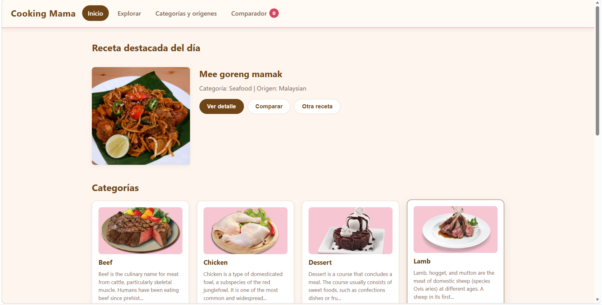
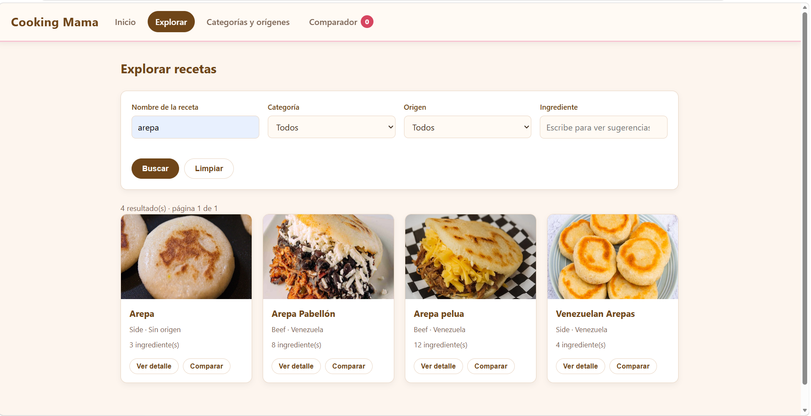
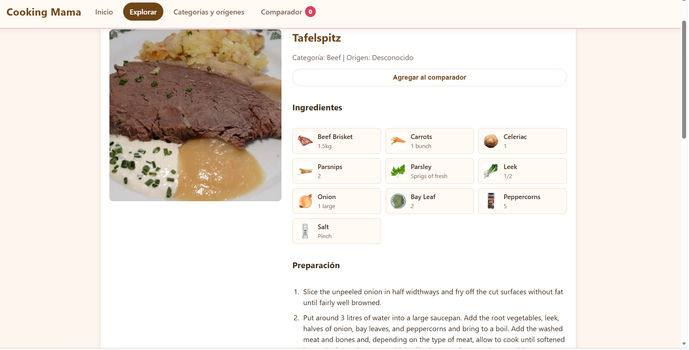
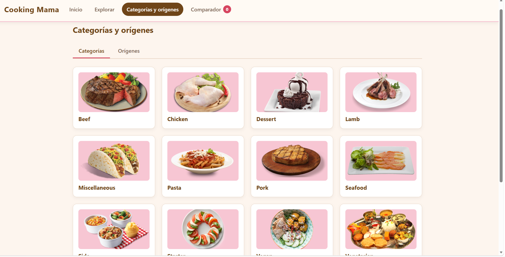
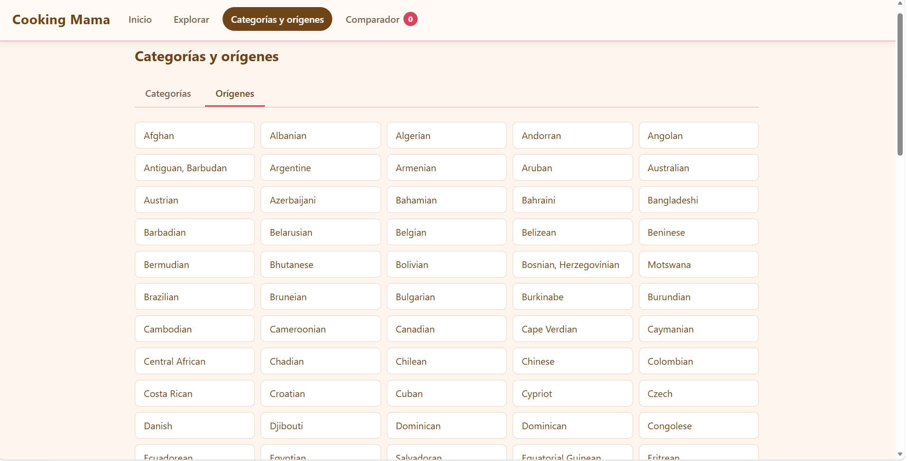
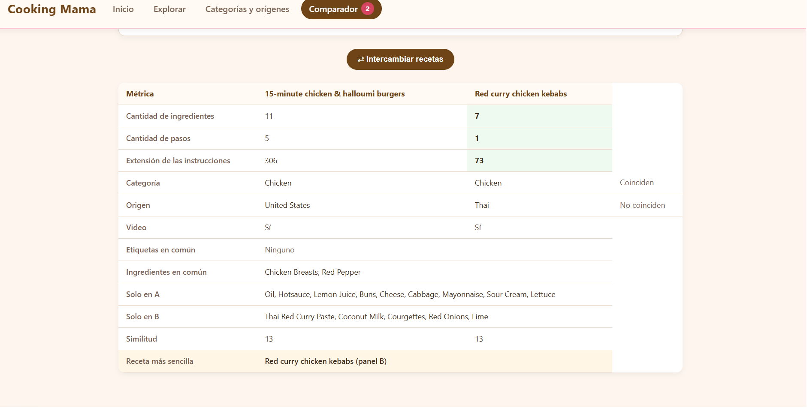

# [The mealDB - Recetario]


Aplicación Web de Página Única (SPA) desarrollada íntegramente con **HTML5, CSS3 y JavaScript puro (Vanilla JS)** bajo una arquitectura modular basada en **componentes** (pseudocomponentes orientados a objetos). La aplicación consume la API pública [TheMealDB](https://www.themealdb.com/) para buscar, filtrar, visualizar detalles y comparar recetas de cocina en tiempo de ejecución.

---

---

## Características Principales

La aplicación cuenta con **5 vistas dinámicas** construidas mediante la composición de componentes reutilizables, manteniendo el estado de navegación sin recargar el navegador:

- **Inicio:** Muestra una receta destacada aleatoria (sin repeticiones consecutivas) y el catálogo completo de categorías cargados de forma independiente.
- **Explorar con Filtros Combinados:** Búsqueda por nombre, categoría, origen (cocina) e ingrediente (con autocompletado). Combina criterios mediante **intersección lógica**, ordena alfabéticamente e incluye paginación en cliente (12 recetas por página) con resolución de detalles bajo demanda.
- **Detalle de Receta:** Visualización completa con ingredientes (e imagen de respaldo ante fallos de carga), instrucciones limpias paso a paso, etiquetas normalizadas, enlace a YouTube y dos secciones de recetas relacionadas (por categoría y por origen).
- **Categorías y Orígenes:** Navegación por pestañas para explorar el catálogo agrupado por tipo de plato o región geográfica.
- **Comparador de Recetas (A vs. B):** Permite enfrentar dos recetas distintas (mediante buscador interno con *debounce* y cancelación de peticiones o agregándolas desde cualquier vista), calculando métricas como ingredientes en común/exclusivos, porcentaje de similitud y veredicto automático de **receta más sencilla**.

---

## Uso de Componentes

Toda la interfaz de usuario está diseñada como una composición de **componentes propios (pseudocomponentes)** implementados con clases de JavaScript, sin utilizar Web Components nativos (`customElements.define`) ni Shadow DOM.

- **Uso de Encapsulamiento:** Cada componente gestiona su propio contenedor, estado interno, renderizado y listeners, utilizando métodos públicos controlados (como `setEstado()`, `setValores()`, `setPagina()` o `setReceta()`) etc.
- **Reutilización:** Componentes clave como `TarjetaReceta`, `PanelComparador`, `Paginador` y `EstadoCarga` se instancian múltiples veces en distintas vistas con diferentes propiedades y conjuntos de datos.
- **Desacoplamiento:** Los componentes no manipulan el DOM interno de otros componentes; la comunicación se realiza mediante eventos personalizados (`CustomEvent`) y funciones *callback* inyectadas a través de `props`.

##  Restricciones

- **HTML5 Semántico:** Unico punto de entrada (`index.html`) con contenedores dinámicos donde se montan las vistas y componentes para el proyecto.
- **CSS3 Moderno (Diseño Propio):** Maquetación responsiva con **CSS Grid** y **Flexbox**, transiciones entre vistas, *skeleton loaders* contextuales y estados `:hover` / `:focus-visible` accesibles, sin frameworks externos.
- **Vanilla JavaScript (ES6+):**
  - libre de librerías o frameworks externos en su totalidad.
  - No hay persistencia en navegador (`localStorage`, `sessionStorage` o cookies); todo el estado se encuentra en memoria durante la sesión.
  - Seguridad contra XSS: todos los datos que provienen de la API se inyectan mediante `textContent` o atributos seguros, reservando `innerHTML` exclusivamente para estructuras estáticas.
  - Sin uso de `alert()`, `confirm()` o `prompt()`.

---

## Estructura del Proyecto

Los scripts se cargan de forma ordenada en `index.html` respetando la jerarquía de dependencias (servicios -> componentes -> vistas -> controlador principal):

```text
/[nombre-del-repo]
├── index.html                      # Estructura base (navbar y contenedor de vistas)
├── README.md                       # Documentación técnica del proyecto
├── css/
│   └── styles.css                  # Variables, layout responsivo, animaciones y temas
└── js/
    ├── servicios/
    │   ├── api.js                  # Cliente HTTP centralizado y manejo de errores
    │   ├── cache.js                # Caché en memoria (Map) para recetas y catálogos
    │   ├── recetas.js              # Normalización (ingredientes 1..20, pasos, tags)
    │   └── comparacion.js          # Lógica de intersección y cálculo de métricas
    ├── componentes/
    │   ├── BarraNavegacion.js      # Menú permanente y contador dinámico del comparador
    │   ├── TarjetaReceta.js        # Tarjeta reutilizable (completa e incompleta)
    │   ├── Paginador.js            # Control de paginación en cliente (12 items/pág)
    │   ├── FormularioBusqueda.js   # Filtros combinables y sugerencias de ingredientes
    │   ├── ListaIngredientes.js    # Renderizado de ingredientes con fallback de imagen
    │   ├── PasosPreparacion.js     # Formateo numerado de instrucciones
    │   ├── PanelComparador.js      # Panel individual (A/B) con buscador interno
    │   ├── TablaComparacion.js     # Matriz comparativa y cálculo de receta más sencilla
    │   └── EstadoCarga.js          # Skeletons, estados vacíos y mensajes de error/reintento
    ├── vistas/
    │   ├── VistaInicio.js
    │   ├── VistaExplorar.js
    │   ├── VistaDetalle.js
    │   ├── VistaCategoriasOrigenes.js
    │   └── VistaComparador.js
    └── app.js                      # Enrutador SPA, gestión de estado global y ciclo de vida

## Integrantes

- Camila Vilora: Servicios y Vistas
- Reynaldo Caceres: Vistas y Componentes
- Mariel Sanchez: Componentes, CSS e Index

## Documentación de Pseudocomponentes, eventos emitidos

| Componente | Responsabilidad Principal | Eventos Emitidos (`CustomEvent`) | Callbacks (`props`) |
| **`BarraNavegacion`** | Gestión visual de la vista activa y contador del comparador. | `cambiarVista` | — |
| **`EstadoCarga`** | Retroalimentación de estados asíncronos (esqueletos, mensajes y error). | — | `alReintentar` |
| **`FormularioBusqueda`** | Renderizado y validación del formulario de filtrado de recetas. | — | `alBuscar`, `alLimpiar` |
| **`ListaIngredientes`** | Listado de ingredientes con imágenes y respaldo SVG ante errores. | — | — |
| **`Paginador`** | Navegación entre páginas y resumen de resultados. | — | `alCambiarPagina` |
| **`PanelComparador`** | Gestión individual de un panel del comparador con buscador en vivo. | `quitarDelComparador`, `agregarAlComparador` | — |
| **`PasosPreparacion`** | Renderizado de la lista ordenada de instrucciones de la receta. | — | — |
| **`TablaComparacion`** | Tabla comparativa de métricas y similitudes entre dos recetas. | — | — |
| **`TarjetaReceta`** | Vista resumen de una receta con acciones rápidas y estado incompleto. | `abrirDetalle`, `agregarComparador` | `alReintentar` |

---
## Uso de promesas

La aplicación combina `Promise.all` y `Promise.allSettled` según la dependencia entre las peticiones asíncronas:

### `Promise.all` 
* **`VistaExplorar.js` → `buscar(criterios)`:** Ejecuta en paralelo los filtros activos del formulario (nombre, categoría, origen e ingrediente). Se utiliza `Promise.all` porque la búsqueda realiza una intersección de resultados; si falla una sola petición, no es posible calcular una coincidencia exacta y se muestra un error general.

### `Promise.allSettled` (Tolerancia a fallos independientes)
* **`VistaCategoriasOrigenes.js` → `cargarListas()`:** Carga simultáneamente categorías y orígenes. Si una lista falla, la otra pestaña sigue funcionando con normalidad.
* **`VistaDetalle.js` `cargarRelacionadas()`:** Obtiene recetas relacionadas por categoría y por origen en paralelo, renderizando cada bloque de forma independiente aunque uno de los dos falle.
* **`VistaExplorar.js`  `cargarListas()`:** Carga las listas para los selectores y el autocompletado del formulario (categorías, orígenes e ingredientes), permitiendo usar el buscador aunque alguna lista no cargue.
* **`VistaInicio.js`  `cargar()`:** Solicita la receta destacada aleatoria y la cuadrícula de categorías al mismo tiempo, aislando cualquier error de red a su propia sección.


## Referencias de Inspiración
La identidad visual y la experiencia de usuario están inspiradas directamente en la franquicia de videojuegos **Cooking Mama**:
* **Estética cálida y acogedora:** Uso de fondos en tonos crema/pastel, tarjetas con bordes redondeados (`12px` y `8px`), botones tipo píldora (`999px`) y sombras suaves que transmiten la calidez de un recetario ilustrado.
* **Jerarquía visual clara:** Separación marcada entre bloques de información, etiquetas tipo *badge* para el comparador y estados de carga

### Paleta de Colores
La paleta parte de los colores característicos de *Cooking Mama* (rosados, marrones cálidos y tonos crema), implementada mediante variables CSS (`:root`) adaptadas para garantizar un contraste legible:

| Variable CSS / Referencia | Color | HEX | RGB | Uso en la interfaz |
| :--- | :--- | :--- | :--- | :--- |
| `--cooking-marron` | **Marrón Cálido** | `#6f4518` | `rgb(111, 69, 24)` | Color primario: títulos, botones principales, enlaces activos y notificaciones *toast*. |
| `--cooking-marron-claro` | **Marrón Suave** | `#8b5a2b` | `rgb(139, 90, 43)` | Estados *hover* de botones principales y bordes interactivos. |
| `--cooking-rosa` | **Rosa Acento** | `#d64560` | `rgb(214, 69, 96)` | Insignias (*badges*) del comparador, pestañas activas, avisos y anillo de enfoque (`outline`). |
| `--cooking-rosa-claro` | **Rosa Pastel** | `#f7c6d3` | `rgb(247, 198, 211)` | Estados *hover* en navegación y botones secundarios, etiquetas, borde inferior del menú y fondo de imágenes. |
| `--cooking-crema` | **Crema** | `#fffaf4` | `rgb(255, 250, 244)` | Barra de navegación fija, controles de formulario, tarjetas de ingredientes y cabecera de tablas. |
| `--cooking-fondo` | **Fondo General** | `#fdf5ee` | `rgb(253, 245, 238)` | Fondo base de toda la aplicación. |
| `--cooking-texto` / `--cooking-texto-suave` | **Marrón Oscuro / Gris Cálido** | `#3f2d1e` / `#7a6353` | `rgb(63, 45, 30)` | Texto principal de alta legibilidad y metadatos o descripciones secundarias. |
| *Estados semánticos* | **Carmesí / Verde / Ámbar** | `#a12a43` / `#eefaf0` / `#fff6e6` | — | Mensajes de error y validación (`#a12a43`), métrica ganadora (`#eefaf0`) y fila destacada en comparación (`#fff6e6`). |

## Tipografías
**Familia tipográfica:** `'Segoe UI', Tahoma, Geneva, Verdana, sans-serif` (pila *sans-serif* nativa de alta legibilidad y renderizado rápido sin dependencias externas).
**Escala y pesos:** Títulos destacados en negrita (`700`) con ligero espaciado de letras (`0.02em`) en el logotipo, botones y etiquetas en seminegrita (`600`), y cuerpo de texto con interlineado cómodo (`line-height: 1.5`) para facilitar la lectura de ingredientes y pasos.

## Criterio de Iconografía e Imágenes
* **Minimalismo con glifos Unicode:** Uso de símbolos tipográficos universales (`←`, `⇄`) en botones de navegación e intercambio para mantener la interfaz ligera y evitar librerías de iconos externas.
* **Tratamiento fotográfico y respaldo SVG:** Imágenes con ajuste `object-fit: cover` en tarjetas (`160px` / `120px`) y `object-fit: contain` en miniaturas de ingredientes (`36px × 36px`), aplicando carga diferida (`loading="lazy"`) y un respaldo vectorial (`SVG`) integrado en tonos crema/terracota cuando falla la carga de un recurso externo.
* **Accesibilidad:** Indicadores de foco visibles (`outline: 3px solid var(--cooking-rosa)`) y soporte para `@media (prefers-reduced-motion: reduce)` que desactiva animaciones si el usuario lo prefiere.

## Capturas de Pantalla

### Inicio


### Explorar


### Detalle de Receta


### Categorías y Orígenes



### Comparador


